<!--
  ⚡ WORLD-CLASS GITHUB PROFILE README — ADITHYA R KULKARNI (@Tech-Adii)
  Portfolio: https://about-adithya.netlify.app | LinkedIn: https://linkedin.com/in/adithya-r-kulkarni
-->

<!-- BESPOKE SILICON-TO-NEURAL HERO ARTWORK -->

 

<!-- CUSTOM ANIMATED IDENTITY NAMEPLATE -->

 

<!-- ANIMATED TYPEWRITER SUBTITLE -->

 

<!-- PRIMARY ACTION PILLS -->

&nbsp;

&nbsp;

  

<!-- CREDENTIAL & SIGNAL STRIP -->

&nbsp;

&nbsp;

&nbsp;

&nbsp;

&nbsp;

  

**Bridging silicon and software — combining bare-metal electronics intuition with on-device computer vision, machine learning security, and full-stack engineering.**

 

[About](#about) • [Philosophy](#philosophy) • [Flagship Builds](#projects) • [Hardware & IoT](#hardware) • [Research & Impact](#impact) • [Tech Stack](#stack) • [Journey](#journey) • [Analytics](#analytics) • [Connect](#connect)

 

## 👨‍💻 About Me

I'm **Adithya R Kulkarni (`@Tech-Adii`)**, pursuing a **B.E. in Computer Science & Engineering (Artificial Intelligence & Machine Learning)** at **RV College of Engineering (RVCE), Bengaluru**, building on a diploma foundation in **Electronics & Communication Engineering**.

My engineering path started with microcontrollers, RFID arrays, and autonomous sensor bots. Today, I channel that hardware-first systems intuition into **on-device computer vision, adversarial ML security (model extraction & watermarking), real-time AI verification pipelines, and privacy-first desktop software**.

* 🎓 **Degree:** B.E. CSE (AI & ML) at **RV College of Engineering (RVCE), Bengaluru** · Lateral Entry · Class of 2029.
* 🏆 **Milestones:** **State Rank 38** in Karnataka DCET 2026 · **9.92 CGPA (Gold Medalist & Student of the Year)** in Diploma ECE.
* 🔬 **Active Focus:** Edge Computer Vision (`MediaPipe WASM`), ML Intellectual Property & Watermarking, Temporal AI Verification Gateways, and Quantum Graph Routing.
* 🌐 **Public Impact:** Built open-access Karnataka DCET portals ([Top Engineering Colleges Directory](https://topenggfordcet.netlify.app), C-20 Rank Predictors, Seat Aggregators) and lead a **12K+ subscriber** tech community.

 

  

 

## ⚡ Engineering Philosophy

<table>
  <tr>
    <td width="25%" align="center" valign="top">
       
      
        
      <b>Zero-Compromise Privacy</b>
      
Software must respect user sovereignty. On-device inference, volatile RAM processing, and zero telemetry by default.

    </td>
    <td width="25%" align="center" valign="top">
       
      
        
      <b>Hardware-Software Co-Design</b>
      
Understanding cache lines, sensor noise, bus bottlenecks, and memory footprints produces resilient high-level architectures.

    </td>
    <td width="25%" align="center" valign="top">
       
      
        
      <b>Benchmark-Driven Craft</b>
      
No claims without automated proof. Rigorous unit suites, desktop E2E harnesses, and verifiable test telemetry.

    </td>
    <td width="25%" align="center" valign="top">
       
      
        
      <b>Direct Human Impact</b>
      
Engineering should solve real human bottlenecks—from preventing digital eye strain to empowering student admissions.

    </td>
  </tr>
</table>

 

## 🚀 Flagship Projects

<table>
  <tr>
    <td width="50%" valign="top">
      

        <h3>💻 01 · <a href="https://github.com/Tech-Adii/ScreenWell">ScreenWell</a></h3>
        
<b>100% Offline Desktop AI Wellness Companion</b>

        

          
          
          
        

      

      
Ultra-private desktop health companion built for <b>CS238DL</b> and aligned with <b>UN SDG 3</b>, engineered directly from a 91-student empirical study.

      
<code>Electron 45</code> <code>React 19</code> <code>MediaPipe WASM</code> <code>TypeScript</code> <code>SQLite WAL</code> <code>Playwright</code>

      <ul>
        <li><b>Local Vision Workers:</b> Computes EAR blink rates, 3D posture scores (threshold: 80), and proximity alerts at 5–8 FPS strictly in volatile RAM.</li>
        <li><b>Zero Network Leakage:</b> Camera defaults to OFF, served over local <code>screenwell://app</code> protocol with strict CSP blocking external endpoints.</li>
        <li><b>Deep Focus UX:</b> Study profiles, Windows Taskbar countdown badge, non-blocking <code>showInactive()</code> alerts, 20-20-20 eye rest, 16 stretches, and PDF/CSV reports.</li>
      </ul>
      

        <a href="https://github.com/Tech-Adii/ScreenWell"><b>[Source Code]</b></a> • 
        <a href="https://github.com/Tech-Adii/ScreenWell/releases/tag/v1.14.0"><b>[v1.14.0 Setup]</b></a> • 
        <a href="https://github.com/Tech-Adii/ScreenWell/blob/main/VALIDATION.md"><b>[Audit Record]</b></a>
      

    </td>
    <td width="50%" valign="top">
      

        <h3>🛡️ 02 · <a href="https://github.com/Tech-Adii/freshguard-ai">FreshGuard AI</a></h3>
        
<b>Real-Time Fact Shield for Generative AI</b>

        

          
          
          
        

      

      
Real-time temporal obsolescence and hallucination interceptor built for the <b>Geek Room Global AI Hackathon (HackCulture)</b> — AI Agents track.

      
<code>Python</code> <code>FastAPI Async</code> <code>Bifrost Gateway</code> <code>Tavily API</code> <code>Gemini 3.5</code> <code>Pytest</code>

      <ul>
        <li><b>Temporal Drift Interceptor:</b> Inspects generated LLM responses in real time to flag outdated claims, stale numbers, and temporal hallucinations.</li>
        <li><b>Live Web Grounding:</b> Dispatches concurrent verification queries via Tavily Search API (Nebius) against fresh ground-truth sources.</li>
        <li><b>Resilient Routing:</b> Orchestrated on Bifrost AI Gateway (Maxim AI) for unified telemetry, dynamic model fallbacks, and strict latency SLAs.</li>
      </ul>
      

        <a href="https://github.com/Tech-Adii/freshguard-ai"><b>[Source Code]</b></a> • 
        <a href="https://github.com/Tech-Adii/freshguard-ai/blob/main/PITCH_DECK.md"><b>[Pitch Deck]</b></a> • 
        <a href="https://github.com/Tech-Adii/freshguard-ai/blob/main/SUBMISSION.md"><b>[Submission Docs]</b></a>
      

    </td>
  </tr>
  <tr>
    <td width="50%" valign="top">
      

        <h3>🔬 03 · <a href="https://github.com/Tech-Adii/modeltrace-watermark-demo">ModelTrace</a></h3>
        
<b>Model Extraction &amp; Neural Watermark Security</b>

        

          
          
          
        

      

      
Interactive ML security testbed exploring black-box surrogate model extraction attacks and trigger-based neural ownership verification.

      
<code>Python</code> <code>PyTorch</code> <code>FastAPI</code> <code>Streamlit</code> <code>Adversarial ML</code>

      <ul>
        <li><b>Surrogate Extraction:</b> Simulates black-box model stealing where an adversary clones a teacher classifier using API probability outputs.</li>
        <li><b>Backdoor Watermarking:</b> Embeds secret trigger patterns during training that survive extraction without degrading clean accuracy.</li>
        <li><b>Audit Dashboard:</b> Side-by-side prediction comparison, trigger injection controls, and statistical ownership confidence verification.</li>
      </ul>
      

        <a href="https://github.com/Tech-Adii/modeltrace-watermark-demo"><b>[Source Code]</b></a> • 
        <a href="https://modeltrace-watermark-demo-2fyh3a9qpi3dco3cz5sx9m.streamlit.app/"><b>[Launch Live Demo]</b></a>
      

    </td>
    <td width="50%" valign="top">
      

        <h3>🏪 04 · <a href="https://github.com/Tech-Adii/KIRANA">KiranaMitra AI</a></h3>
        
<b>Smart Retail Inventory &amp; Purchase Planner</b>

        

          
          
          
        

      

      
Practical AI operations co-pilot designed for local retail stores—converting supplier bill photos into live inventory alerts and restock plans.

      
<code>React</code> <code>FastAPI</code> <code>Python</code> <code>SQLAlchemy 2</code> <code>SQLite</code> <code>Gemini Vision</code>

      <ul>
        <li><b>Multimodal Invoice OCR:</b> Parses photographed paper supplier invoices into structured SKU names, quantities, and unit prices via Gemini.</li>
        <li><b>Expiry &amp; Stock Guard:</b> Flags low-stock items and near-expiry perishables against 7-day rolling sales baselines.</li>
        <li><b>Human-Approved Procurement:</b> Synthesizes budget-constrained purchase recommendations requiring explicit shopkeeper sign-off.</li>
      </ul>
      

        <a href="https://github.com/Tech-Adii/KIRANA"><b>[Source Code]</b></a> • 
        <a href="https://github.com/Tech-Adii/KIRANA#technology-map"><b>[Technology Map]</b></a>
      

    </td>
  </tr>
</table>

 

## 🤖 Hardware, Embedded &amp; Robotics Lab

> *"Before I trained neural networks, I learned how electricity behaves: writing bare-metal firmware, managing sensor noise, and wiring autonomous machines."*

<table>
  <thead>
    <tr>
      <th width="32%">Hardware System</th>
      <th width="30%">Core Stack &amp; Components</th>
      <th width="38%">Engineering Highlights</th>
    </tr>
  </thead>
  <tbody>
    <tr>
      <td><b>🛒 Smart Shopping Trolley</b> <a href="https://github.com/Tech-Adii/SMART-SHOPPING-TROLLEY"><code>Tech-Adii/SMART-SHOPPING-TROLLEY</code></a></td>
      <td><code>Arduino Nano</code> · <code>MFRC522 RFID</code> · <code>ST7735 TFT</code> · <code>SIM800L GSM</code> · <code>C++</code></td>
      <td>In-cart RFID product scanning, live itemized billing on TFT display, dynamic <b>UPI QR code</b> generation for instant checkout, and automated <b>GSM SMS</b> receipts.</td>
    </tr>
    <tr>
      <td><b>📡 IoT RFID Attendance System</b> <a href="https://github.com/Tech-Adii/IOT-BASED-RFID-ATTENDENCE-SYSTEM"><code>Tech-Adii/IOT-BASED-RFID-ATTENDENCE-SYSTEM</code></a></td>
      <td><code>ESP32</code> · <code>MFRC522 RFID</code> · <code>I2C LCD 16x2</code> · <code>Google Apps Script</code></td>
      <td>Wi-Fi connected contactless attendance terminal logging check-in/check-out events straight to Google Sheets with buzzer feedback and unknown-card alerts.</td>
    </tr>
    <tr>
      <td><b>🚧 Obstacle Avoidance Robot</b> <a href="https://github.com/Tech-Adii/OBSTACLE-AVOIDANCE-ROBOT"><code>Tech-Adii/OBSTACLE-AVOIDANCE-ROBOT</code></a></td>
      <td><code>Arduino</code> · <code>HC-SR04 Ultrasonic</code> · <code>SG90 Servo</code> · <code>L298N</code> · <code>C++</code></td>
      <td>Autonomous mobile platform scanning left/right clearance arcs via servo-mounted ultrasonic rangefinder and steering dynamically toward unobstructed paths.</td>
    </tr>
    <tr>
      <td><b>🏠 ESP32 IoT Home Automation</b> <a href="https://github.com/Tech-Adii/Home-Automation-using-ESP32-Blynk"><code>Tech-Adii/Home-Automation-using-ESP32-Blynk</code></a></td>
      <td><code>ESP32</code> · <code>Blynk IoT</code> · <code>Relay Array</code> · <code>Embedded C++</code></td>
      <td>Cloud-synchronized multi-channel appliance control and live relay telemetry accessible remotely from mobile dashboards.</td>
    </tr>
    <tr>
      <td><b>🔔 Automatic School Bell System</b> <a href="https://github.com/Tech-Adii/AUTOMATIC-SCHOOL-BELL-PROJECT"><code>Tech-Adii/AUTOMATIC-SCHOOL-BELL-PROJECT</code></a></td>
      <td><code>Arduino Nano</code> · <code>RTC Timing</code> · <code>16x2 LCD</code> · <code>Relay / Buzzer</code></td>
      <td>Deterministic microcontroller bell scheduler automating morning assembly, class periods, lunch breaks, and dismissal without manual intervention.</td>
    </tr>
    <tr>
      <td><b>🧪 Physical Lab Prototypes</b> Human-Following Bot · Smart Parking · Ultrasonic Radar</td>
      <td><code>Arduino</code> · <code>ESP32</code> · <code>HC-05 Bluetooth</code> · <code>IR / GPS / GSM</code></td>
      <td>Dual-mode Bluetooth/autonomous target-following robot, ESP32 multi-bay IR parking gate controller, and 180° Processing radar scanner.</td>
    </tr>
  </tbody>
</table>

 

## 🌍 Research &amp; Open-Source Community Impact

<table>
  <tr>
    <td width="50%" valign="top">
      <h3>🎓 Open-Access DCET Student Ecosystem</h3>
      
Built and shipped free web utilities helping thousands of Karnataka diploma graduates navigate lateral-entry engineering admissions with clarity:

      <ul>
        <li><b><a href="https://topenggfordcet.netlify.app">Top Engineering Colleges Directory</a>:</b> Live searchable college explorer for Karnataka DCET aspirants.</li>
        <li><b>C-20 CGPA &amp; Rank Predictor:</b> Transparent score-to-rank estimation and option-entry seat matrix aggregator.</li>
        <li><b>12,000+ Subscriber YouTube Community:</b> Educational deep-dives on engineering paths, DCET guidance, and practical tech builds.</li>
      </ul>
    </td>
    <td width="50%" valign="top">
      <h3>⚛️ Applied Systems &amp; Research Prototypes</h3>
      
Experimental architectures exploring next-generation optimization and resilient cyber-physical infrastructure:

      <ul>
        <li><b>Quantum Route Optimization:</b> QUBO graph-routing formulation prototype (<code>Flask</code> + <code>Leaflet.js</code>) modeling shortest-path urban logistics across Bengaluru corridors.</li>
        <li><b>Off-Grid Microgrid Diagnostics:</b> Sensor time-series anomaly detection for decentralized renewable energy microgrids.</li>
        <li><b>Edge TinyML Exploration:</b> Quantized computer vision and real-time audio/sensor inference on constrained embedded silicon.</li>
      </ul>
    </td>
  </tr>
</table>

 

## 🛠️ Technical Arsenal

#### Languages &amp; Core Runtimes

  

#### AI, Desktop, Full-Stack &amp; Hardware Tooling

  

  

#### Specialized Platforms &amp; Ecosystem Badges

  
  
  
  
  
  

 

<table>
  <thead>
    <tr>
      <th width="26%">Domain</th>
      <th width="74%">Proficiencies &amp; Core Technologies</th>
    </tr>
  </thead>
  <tbody>
    <tr>
      <td><b>AI &amp; Computer Vision</b></td>
      <td>PyTorch, MediaPipe Tasks Vision (WASM Web Workers), Gemini Multimodal API, OpenCV, Scikit-Learn, NumPy, Streamlit, Black-Box Model Extraction &amp; Watermarking</td>
    </tr>
    <tr>
      <td><b>Full-Stack &amp; Desktop</b></td>
      <td>Electron 45, React 19, TypeScript, FastAPI (Async), Flask, SQLite (WAL), SQLAlchemy 2, Tailwind CSS, Vite, Leaflet.js</td>
    </tr>
    <tr>
      <td><b>Quality &amp; Automation</b></td>
      <td>Vitest (118+ unit tests), Playwright (Desktop E2E scenarios), Pytest, GitHub Actions CI/CD, Offline CSP Scanners</td>
    </tr>
    <tr>
      <td><b>Embedded &amp; IoT</b></td>
      <td>Arduino UNO/Nano, ESP32, ESP8266, Raspberry Pi, Embedded C/C++, MFRC522 RFID, SIM800L GSM, HC-05 Bluetooth, ST7735 TFT</td>
    </tr>
  </tbody>
</table>

 

## 🎓 Academic &amp; Engineering Journey

  

 

| Period | Milestone &amp; Qualification | Institution / Authority | Key Distinctions |
| :--- | :--- | :--- | :--- |
| **2026 – 2029** | **B.E. Computer Science &amp; Engineering (AI &amp; ML)** | **RV College of Engineering (RVCE), Bengaluru** | Lateral Entry admission into premier engineering institute. |
| **2026** | **Karnataka DCET 2026 — State Rank 38** | Karnataka Examination Authority (KEA) | Top percentile merit rank statewide across thousands of aspirants. |
| **2023 – 2026** | **Diploma in Electronics &amp; Communication** | **M.E.S. R.N. Shetty Polytechnic, Sirsi** | **9.92 CGPA** · *Department Gold Medalist* &amp; *Student of the Year*. |

 

## 📊 Live GitHub Telemetry &amp; Analytics

<!-- AUTOMATED CONTRIBUTION SNAKE (ADAPTS TO LIGHT/DARK MODE) -->
<picture>
  <source media="(prefers-color-scheme: dark)" srcset="https://raw.githubusercontent.com/Tech-Adii/Tech-Adii/output/github-contribution-grid-snake-dark.svg" />
  <source media="(prefers-color-scheme: light)" srcset="https://raw.githubusercontent.com/Tech-Adii/Tech-Adii/output/github-contribution-grid-snake.svg" />
  
</picture>

 

&nbsp;

  

  

 

## 🤝 Connect &amp; Collaborate

**Always open to collaborating on applied AI research, on-device computer vision, hardware-software co-design, hackathons, and open-source engineering.**

 

&nbsp;

&nbsp;

  

<!-- CUSTOM ANIMATED FOOTER BANNER -->

