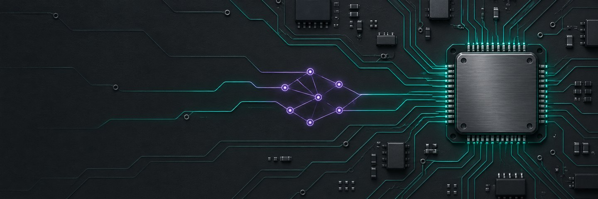

# Adithya R Kulkarni

**AI & machine learning · Software · Embedded systems**

I’m a CSE (AI & ML) student at RV College of Engineering. I started with Arduino, sensors, and robots, and now build AI tools, web apps, and connected hardware.

[Portfolio](https://about-adithya.netlify.app/) · [LinkedIn](https://www.linkedin.com/in/adithya-r-kulkarni) · [All repositories](https://github.com/Tech-Adii?tab=repositories)

## Featured project

### [FreshGuard AI](https://github.com/Tech-Adii/freshguard-ai)

**HackCulture · Team SOL CULTURE**

I built FreshGuard AI with Manisha M Kulkarni. It checks time-sensitive claims in language model responses against live web sources and suggests updates when it finds stale information.

`Python` `FastAPI` `Tavily` `Bifrost`

## Selected projects

| Project | What it does |
| :--- | :--- |
| **[ModelTrace](https://github.com/Tech-Adii/modeltrace-watermark-demo)** | An interactive ML security demo that tests whether a neural-network watermark appears in a second classifier. **PyTorch · Streamlit · FastAPI** |
| **[KiranaMitra AI](https://github.com/Tech-Adii/KIRANA)** | A small-shop inventory prototype that flags low stock and expiry risk and proposes purchases within a budget. **React · FastAPI · SQLite** |
| **[Smart Shopping Trolley](https://github.com/Tech-Adii/SMART-SHOPPING-TROLLEY)** | An RFID-enabled cart with a live running total, UPI QR checkout, and SMS billing. **Arduino · C++ · RFID · GSM** |
| **[RFID Attendance System](https://github.com/Tech-Adii/IOT-BASED-RFID-ATTENDENCE-SYSTEM)** | A tap-in, tap-out attendance system that logs scans to Google Sheets. **ESP32 · RFID · Apps Script** |
| **[Obstacle Avoidance Robot](https://github.com/Tech-Adii/OBSTACLE-AVOIDANCE-ROBOT)** | An Arduino robot that compares clearance on both sides before steering around obstacles. **Arduino · C++ · Ultrasonic sensing** |

[ESP32 home automation](https://github.com/Tech-Adii/Home-Automation-using-ESP32-Blynk) · [Automatic school bell](https://github.com/Tech-Adii/AUTOMATIC-SCHOOL-BELL-PROJECT)

## Education & current focus

- **B.E. in CSE (AI & ML)** · RV College of Engineering, Bengaluru · Class of 2029
- **Diploma in Electronics & Communication Engineering** · R. N. Shetty Polytechnic, Sirsi · 9.92 CGPA
- **Karnataka DCET 2026** · Rank 38

I’m currently working on data structures and algorithms, machine learning fundamentals, and building AI applications with reliable sources and clear evaluations.
