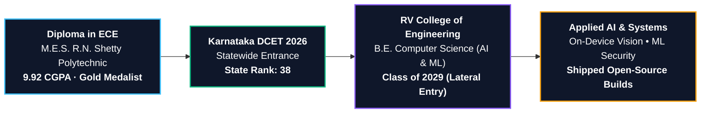

<!--
  ⚡ ULTIMATE GITHUB PROFILE README — ADITHYA R KULKARNI (@Tech-Adii)
  Portfolio: https://about-adithya.netlify.app | LinkedIn: https://linkedin.com/in/adithya-r-kulkarni
-->

<div align="center">

<!-- HERO BANNER -->


<!-- ANIMATED TYPING SUBTITLE -->
<a href="https://github.com/Tech-Adii">
  
</a>

<br/>

<!-- PRIMARY SOCIAL & ACTION PILLS -->
<a href="https://about-adithya.netlify.app">
  
</a>
&nbsp;
<a href="https://www.linkedin.com/in/adithya-r-kulkarni">
  
</a>
&nbsp;
<a href="https://github.com/Tech-Adii?tab=repositories">
  
</a>

<br/><br/>

<!-- CREDENTIAL & SIGNAL STRIP -->

&nbsp;

&nbsp;

&nbsp;

&nbsp;

&nbsp;


<br/><br/>

**Bridging silicon and software — combining bare-metal electronics intuition with on-device computer vision, machine learning security, and full-stack software architecture.**

[About Me](#-about-me) • [Engineering Philosophy](#-engineering-philosophy) • [Flagship Builds](#-flagship-projects) • [Hardware & IoT Lab](#-hardware--iot-lab) • [Tech Stack](#-technical-arsenal) • [Journey](#-academic--engineering-journey) • [Analytics](#-github-analytics) • [Connect](#-connect--collaborate)

</div>

---

## 👨‍💻 About Me

I'm **Adithya R Kulkarni (`@Tech-Adii`)**, an engineer pursuing my **B.E. in Computer Science & Engineering (Artificial Intelligence & Machine Learning)** at **RV College of Engineering (RVCE), Bengaluru**, grounded in a diploma background in **Electronics & Communication Engineering**.

My passion began at the hardware level: soldering sensor arrays, tracing oscilloscope signals, and designing autonomous robotics. Today, I bring that physical-world systems intuition into **applied AI agent architecture, on-device edge computer vision, adversarial ML security (model extraction & watermarking defenses), and high-performance desktop software**.

* 🎓 **Current Degree:** B.E. CSE (AI & ML) at **RV College of Engineering (RVCE), Bengaluru** · Lateral Entry · Class of 2029.
* 🏆 **Academic Distinction:** **State Rank 38** in Karnataka DCET 2026 · **9.92 CGPA (Gold Medalist & Student of the Year)** in Diploma in ECE at M.E.S. R.N. Shetty Polytechnic, Sirsi.
* 💡 **Active Research & Builds:** Edge AI (MediaPipe WASM / on-device inference), ML Security (Black-box Model Extraction & Trigger Watermarking), Temporal AI Verification Gateways, and Quantum Route Optimization.
* 🌐 **Public Impact:** Creator of free Karnataka DCET educational tools ([Top Engineering Colleges Directory](https://topenggfordcet.netlify.app), C-20 Rank Predictors, Seat Matrix Aggregators) and leader of a **12K+ subscriber** tech education community.
* 🎯 **Engineering Creed:** *"Understand the system from first principles. Build the smallest working prototype. Benchmark, harden, and ship with purpose."*

```python
from dataclasses import dataclass
from typing import List, Dict

@dataclass
class Engineer:
    name: str = "Adithya R Kulkarni"
    handle: str = "@Tech-Adii"
    university: str = "RV College of Engineering (RVCE), Bengaluru"
    academics: str = "B.E. CSE (AI & ML) | ECE Diploma (9.92 CGPA, Rank 38)"
    domains: List[str] = (
        "On-Device AI & Computer Vision",
        "ML Security & Model Watermarking",
        "Full-Stack & Desktop Software",
        "Embedded IoT & Autonomous Robotics",
    )
    flagships: List[str] = (
        "ScreenWell (v1.14.0)",
        "FreshGuard AI",
        "ModelTrace",
        "KiranaMitra AI",
        "Smart Shopping Trolley",
    )
    community: str = "12K+ YouTube Community | Free Open-Source DCET Portals"
    workflow: str = "First Principles ➔ Prototype ➔ Benchmark ➔ Harden ➔ Ship"

    def execute(self) -> str:
        return "Building resilient, private, and human-centric software from silicon to the cloud."
```

---

## ⚡ Engineering Philosophy

<table>
  <tr>
    <td width="25%" align="center" valign="top">
      <br/>
      
      <br/><br/>
      <b>Zero-Compromise Privacy</b>
      <p>Software must respect user sovereignty. On-device inference, volatile RAM processing, and zero telemetry by default.</p>
    </td>
    <td width="25%" align="center" valign="top">
      <br/>
      
      <br/><br/>
      <b>Hardware-Software Co-Design</b>
      <p>Understanding cache lines, sensor noise, bus bottlenecks, and memory footprints builds resilient higher-level systems.</p>
    </td>
    <td width="25%" align="center" valign="top">
      <br/>
      
      <br/><br/>
      <b>Empirical Benchmarking</b>
      <p>No assumptions without automated proof. Comprehensive unit tests, end-to-end desktop suites, and reproducible testbeds.</p>
    </td>
    <td width="25%" align="center" valign="top">
      <br/>
      
      <br/><br/>
      <b>Direct Human Impact</b>
      <p>Technology should solve tangible problems—from preventing screen fatigue to democratizing higher-education admissions.</p>
    </td>
  </tr>
</table>

---

## 🚀 Flagship Projects

<table>
  <tr>
    <td width="50%" valign="top">
      <div align="center">
        <h3>💻 01 · <a href="https://github.com/Tech-Adii/ScreenWell">ScreenWell</a></h3>
        <p><b>100% Offline Desktop AI Wellness Companion</b></p>
        <p>
          <a href="https://github.com/Tech-Adii/ScreenWell/releases/tag/v1.14.0"></a>
          <a href="https://github.com/Tech-Adii/ScreenWell/blob/main/VALIDATION.md"></a>
          <a href="https://github.com/Tech-Adii/ScreenWell"></a>
        </p>
      </div>
      <p>An ultra-private desktop health companion built for the <b>Applied Design Thinking Lab (CS238DL)</b> and supporting <b>UN SDG 3: Good Health and Well-Being</b> based on an empirical $N=91$ student survey.</p>
      <p><code>Electron 45</code> <code>React 19</code> <code>MediaPipe Tasks WASM</code> <code>TypeScript</code> <code>SQLite WAL</code> <code>Playwright</code></p>
      <details open>
        <summary><b>Key Engineering Highlights</b></summary>
        <ul>
          <li><b>Local Vision Workers:</b> Executes MediaPipe Face & Pose models (Lite/Full/Heavy at 5–8 FPS) in web workers to compute real-time Eye Aspect Ratio (EAR) blink rate, 3D posture alignment (score threshold: 80), and proximity slouch alerts.</li>
          <li><b>Radical Privacy:</b> Camera is OFF by default, processes frames strictly in volatile RAM (zero frames saved/uploaded), and blocks all external network calls via custom <code>screenwell://app</code> protocol and strict CSP.</li>
          <li><b>Deep Focus Engine:</b> Study profiles (Quick Review, Balanced Study, Practice Exam), live Windows Taskbar badge countdown, tray tooltips, non-blocking <code>showInactive()</code> alerts, 20-20-20 eye routines, 16 desk stretches, and client-side PDF/CSV exports.</li>
        </ul>
      </details>
      <div align="center">
        <a href="https://github.com/Tech-Adii/ScreenWell"><b>[View Source Code]</b></a> • 
        <a href="https://github.com/Tech-Adii/ScreenWell/releases/tag/v1.14.0"><b>[Download v1.14.0 Setup]</b></a> • 
        <a href="https://github.com/Tech-Adii/ScreenWell/blob/main/VALIDATION.md"><b>[Audit Log]</b></a>
      </div>
    </td>
    <td width="50%" valign="top">
      <div align="center">
        <h3>🛡️ 02 · <a href="https://github.com/Tech-Adii/freshguard-ai">FreshGuard AI</a></h3>
        <p><b>Real-Time Fact Shield for Generative AI</b></p>
        <p>
          <a href="https://github.com/Tech-Adii/freshguard-ai"></a>
          <a href="https://github.com/Tech-Adii/freshguard-ai"></a>
          <a href="https://github.com/Tech-Adii/freshguard-ai"></a>
        </p>
      </div>
      <p>A high-performance temporal obsolescence and fact-verification middleware built for the <b>Geek Room Global AI Hackathon (HackCulture)</b> — AI Agents & Intelligent Systems track.</p>
      <p><code>Python</code> <code>FastAPI Async</code> <code>Bifrost AI Gateway</code> <code>Tavily API</code> <code>Gemini 3.5</code> <code>Pytest</code></p>
      <details open>
        <summary><b>Key Engineering Highlights</b></summary>
        <ul>
          <li><b>Temporal Drift Interceptor:</b> Analyzes generated model output in real time to catch stale facts, hallucinatory dates, and obsolete statistics before end-user presentation.</li>
          <li><b>Live Web Verification:</b> Dispatches concurrent search queries through Tavily API via Nebius for low-latency external ground-truth validation.</li>
          <li><b>Resilient Gateway:</b> Orchestrated with Bifrost (Maxim AI) for real-time observability, dynamic multi-model failover routing, and strict latency SLA compliance.</li>
        </ul>
      </details>
      <div align="center">
        <a href="https://github.com/Tech-Adii/freshguard-ai"><b>[View Source Code]</b></a> • 
        <a href="https://github.com/Tech-Adii/freshguard-ai/blob/main/PITCH_DECK.md"><b>[Pitch Deck]</b></a> • 
        <a href="https://github.com/Tech-Adii/freshguard-ai/blob/main/SUBMISSION.md"><b>[Architecture]</b></a>
      </div>
    </td>
  </tr>
  <tr>
    <td width="50%" valign="top">
      <div align="center">
        <h3>🔬 03 · <a href="https://github.com/Tech-Adii/modeltrace-watermark-demo">ModelTrace</a></h3>
        <p><b>Model Extraction & Neural Watermark Security</b></p>
        <p>
          <a href="https://modeltrace-watermark-demo-2fyh3a9qpi3dco3cz5sx9m.streamlit.app/"></a>
          <a href="https://github.com/Tech-Adii/modeltrace-watermark-demo"></a>
          <a href="https://github.com/Tech-Adii/modeltrace-watermark-demo"></a>
        </p>
      </div>
      <p>An interactive ML security testbed demonstrating black-box teacher-student model extraction attacks and cryptographic backdoor watermark verification defenses.</p>
      <p><code>Python</code> <code>PyTorch</code> <code>Streamlit</code> <code>FastAPI</code> <code>Adversarial ML</code></p>
      <details>
        <summary><b>Key Engineering Highlights</b></summary>
        <ul>
          <li><b>Surrogate Extraction Simulation:</b> Mimics black-box query stealing of proprietary image classifiers through API probability vectors.</li>
          <li><b>Backdoor Watermarking:</b> Embeds specialized trigger patterns into the network during training that transfer into stolen surrogates without hurting clean test accuracy.</li>
          <li><b>Interactive Audit Lab:</b> Live prediction diffs, trigger injection controls, confidence bar graphs, and statistical ownership test reports.</li>
        </ul>
      </details>
      <div align="center">
        <a href="https://github.com/Tech-Adii/modeltrace-watermark-demo"><b>[View Source Code]</b></a> • 
        <a href="https://modeltrace-watermark-demo-2fyh3a9qpi3dco3cz5sx9m.streamlit.app/"><b>[Launch Interactive Demo]</b></a>
      </div>
    </td>
    <td width="50%" valign="top">
      <div align="center">
        <h3>🏪 04 · <a href="https://github.com/Tech-Adii/KIRANA">KiranaMitra AI</a></h3>
        <p><b>Smart Retail Inventory & Restocking Planner</b></p>
        <p>
          <a href="https://github.com/Tech-Adii/KIRANA"></a>
          <a href="https://github.com/Tech-Adii/KIRANA"></a>
          <a href="https://github.com/Tech-Adii/KIRANA"></a>
        </p>
      </div>
      <p>An intelligent retail operations co-pilot engineered for small corner stores (kiranas)—transforming physical supplier bills into live inventory management and procurement drafts.</p>
      <p><code>React 19</code> <code>FastAPI</code> <code>Python</code> <code>SQLite</code> <code>Gemini Vision Multimodal</code></p>
      <details>
        <summary><b>Key Engineering Highlights</b></summary>
        <ul>
          <li><b>Multimodal Invoice OCR:</b> Automatically parses handwritten and printed supplier invoices into structured SKU names, quantities, and cost records.</li>
          <li><b>Expiry & Reorder Intelligence:</b> Real-time tracking of perishable items, slow-moving items, and dynamic replenishment thresholds.</li>
          <li><b>Human-in-the-Loop Procurement:</b> Generates cost-optimized distributor purchase orders requiring explicit shopkeeper confirmation.</li>
        </ul>
      </details>
      <div align="center">
        <a href="https://github.com/Tech-Adii/KIRANA"><b>[View Source Code]</b></a> • 
        <a href="https://github.com/Tech-Adii/KIRANA"><b>[Architecture Docs]</b></a>
      </div>
    </td>
  </tr>
</table>

---

## 🤖 Hardware & IoT Lab

> *"Before I trained deep neural networks, I learned how electricity behaves: designing microcode, soldering circuits, managing sensor noise, and building autonomous bots."*

<table>
  <thead>
    <tr>
      <th width="32%">Hardware System</th>
      <th width="30%">Core Stack & Components</th>
      <th width="38%">Engineering Highlights</th>
    </tr>
  </thead>
  <tbody>
    <tr>
      <td><b>🛒 Smart Shopping Trolley</b><br/><a href="https://github.com/Tech-Adii/SMART-SHOPPING-TROLLEY"><code>Tech-Adii/SMART-SHOPPING-TROLLEY</code></a></td>
      <td><code>Arduino Nano</code> · <code>MFRC522 RFID</code> · <code>ST7735 1.8" TFT</code> · <code>SIM800L GSM</code> · <code>C++</code></td>
      <td>Autonomous in-cart item scanning, running total calculation on high-res TFT, dynamic <b>instant UPI QR code</b> generation on screen for cashierless payment, and automated <b>GSM SMS</b> itemized receipts.</td>
    </tr>
    <tr>
      <td><b>📡 IoT RFID Attendance System</b><br/><a href="https://github.com/Tech-Adii/IOT-BASED-RFID-ATTENDENCE-SYSTEM"><code>Tech-Adii/IOT-BASED-RFID-ATTENDENCE-SYSTEM</code></a></td>
      <td><code>ESP32 NodeMCU</code> · <code>MFRC522 RFID</code> · <code>I2C LCD 16x2</code> · <code>Google Apps Script</code></td>
      <td>Cloud-connected contactless attendance terminal logging check-in/out timestamps directly to Google Sheets with buzzer audio confirmation and unknown-card rejection.</td>
    </tr>
    <tr>
      <td><b>🤖 Dual-Mode Human-Following Robot</b><br/><a href="https://github.com/Tech-Adii/HUMAN-FOLLOWING-ROBOT"><code>Tech-Adii/HUMAN-FOLLOWING-ROBOT</code></a></td>
      <td><code>Arduino Uno</code> · <code>HC-SR04 Ultrasonic</code> · <code>IR Array</code> · <code>HC-05 Bluetooth</code> · <code>L298N</code></td>
      <td>Autonomous target tracking maintaining a 20–40 cm distance offset with obstacle avoidance, paired with instantaneous manual Bluetooth override via smartphone app.</td>
    </tr>
    <tr>
      <td><b>🚗 ESP32 Smart Car Parking System</b></td>
      <td><code>ESP32</code> · <code>Infrared Transceivers</code> · <code>SG90 Servo</code> · <code>I2C LCD</code> · <code>Embedded C</code></td>
      <td>Multi-bay parking manager with entrance/exit slot gating, servo barrier actuation, and real-time vacant spot counting.</td>
    </tr>
    <tr>
      <td><b>🧭 Ultrasonic Radar & Load Controller</b></td>
      <td><code>Arduino Nano</code> · <code>HC-SR04</code> · <code>Servo Sweep</code> · <code>Processing IDE</code> · <code>Relay</code></td>
      <td>180-degree radar scanning visualizer mapping physical obstacle coordinates in real time alongside RFID-authenticated AC power control.</td>
    </tr>
    <tr>
      <td><b>🔔 Automatic School Bell System</b><br/><a href="https://github.com/Tech-Adii/AUTOMATIC-SCHOOL-BELL-PROJECT"><code>Tech-Adii/AUTOMATIC-SCHOOL-BELL-PROJECT</code></a></td>
      <td><code>Arduino Nano</code> · <code>DS3231 RTC</code> · <code>16x2 LCD</code> · <code>Piezo Buzzer / Relay</code></td>
      <td>Precision real-time clock automation triggering period bells, morning assembly alerts, break times, and dismissal without human intervention.</td>
    </tr>
  </tbody>
</table>

---

## 🔬 Research & Open-Source Community Impact

```text
  COMMUNITY IMPACT & RESEARCH INITIATIVES
  ├── 🎓 Open-Source DCET Student Ecosystem (Serving thousands of lateral-entry aspirants)
  │   ├── 🏫 Top Engineering Colleges Directory (https://topenggfordcet.netlify.app)
  │   ├── 📊 C-20 Polytechnic CGPA ➔ Rank Predictor
  │   └── 📑 Option-Entry Seat Matrix Analysis & Cutoff Aggregator
  ├── 🎥 12,000+ Subscriber YouTube Channel (Engineering, DCET guidance & tech tutorials)
  ├── ⚛️ Quantum Graph Routing: QUBO Route Optimization over Bengaluru corridors (Flask + Leaflet.js)
  └── 🔋 Off-Grid Renewable Microgrids: Time-Series Sensor Anomaly & Fault Detection
```

---

## 🛠️ Technical Arsenal

<div align="center">

### Languages & Runtime Environments
<p>
  
</p>

### AI, Machine Learning & Vision Frameworks
<p>
  
  &nbsp;
  
  
  
  
</p>

### Full-Stack, Desktop & Data Infrastructure
<p>
  
</p>

### Hardware, Embedded, Testing & Tooling
<p>
  
  &nbsp;
  
  
  
</p>

</div>

<table>
  <thead>
    <tr>
      <th width="28%">Domain</th>
      <th width="72%">Proficiencies & Core Frameworks</th>
    </tr>
  </thead>
  <tbody>
    <tr>
      <td><b>AI & Computer Vision</b></td>
      <td>PyTorch, MediaPipe Tasks Vision (WASM Web Workers), Gemini API, Scikit-Learn, NumPy, OpenCV, Streamlit, Adversarial Model Extraction, Trigger-Based Watermarking</td>
    </tr>
    <tr>
      <td><b>Full-Stack & Desktop</b></td>
      <td>React 19, TypeScript, Electron 45, FastAPI (Async), Flask, SQLite (WAL mode), Tailwind CSS, Vite, RESTful APIs, Leaflet.js</td>
    </tr>
    <tr>
      <td><b>Software Quality & Testing</b></td>
      <td>Vitest (118+ units), Playwright (Desktop E2E automation), Pytest, CI/CD, Automated Offline Security Scanners</td>
    </tr>
    <tr>
      <td><b>Embedded & IoT Systems</b></td>
      <td>Arduino, ESP32, ESP8266, Raspberry Pi, Embedded C/C++, MFRC522 RFID, SIM800L GSM, HC-05 Bluetooth, DS3231 RTC, ST7735 TFT Displays</td>
    </tr>
    <tr>
      <td><b>Workflow & Platforms</b></td>
      <td>Git, GitHub Actions, VS Code, Linux, Netlify, Google Apps Script / Sheets API, Postman</td>
    </tr>
  </tbody>
</table>

---

## 🎓 Academic & Engineering Journey



| Timeline | Milestone & Qualification | Institution / Organization | Significance |
| :--- | :--- | :--- | :--- |
| **2026 – 2029** | **B.E. Computer Science & Engineering (AI & ML)** | **RV College of Engineering (RVCE), Bengaluru** | Lateral Entry admission into premier engineering institution. |
| **2026** | **State Rank 38 — Karnataka DCET 2026** | Karnataka Examination Authority (KEA) | Top percentile merit rank statewide across thousands of candidates. |
| **2023 – 2026** | **Diploma in Electronics & Communication** | **M.E.S. R.N. Shetty Polytechnic, Sirsi** | **9.92 CGPA** · *Department Gold Medalist* & *Student of the Year*. |
| **Ongoing** | **Community Educator & Tech Mentor** | YouTube & Open-Source Portals | 12K+ subscribers · Built free tools guiding thousands into engineering admissions. |

---

## 📊 GitHub Analytics

<div align="center">

<a href="https://github.com/Tech-Adii">
  
</a>
&nbsp;
<a href="https://github.com/Tech-Adii">
  
</a>

<br/><br/>

<a href="https://github.com/Tech-Adii">
  
</a>

<br/><br/>

<a href="https://github.com/Tech-Adii">
  
</a>

</div>

---

## 🌱 Beyond the Terminal

* 🏏 **Cricket Enthusiast**: Die-hard follower of the sport and passionate **Royal Challengers Bengaluru (RCB)** supporter through thick and thin.
* 📚 **Voracious Reader**: Continuous deep-dives into engineering history, distributed systems architecture, and cognitive science.
* 🛠️ **Maker Culture**: Thrilled by the entire spectrum from physical circuit layout to cloud deployments.
* 🎓 **Community Mentorship**: Passionate about breaking barriers for polytechnic and lateral-entry engineering aspirants across Karnataka.

---

## 🤝 Connect & Collaborate

I am always keen to collaborate on **applied AI research, edge computer vision, hardware-software co-design, hackathons, and high-impact open-source systems**.

<div align="center">

<a href="https://www.linkedin.com/in/adithya-r-kulkarni">
  
</a>
&nbsp;
<a href="https://about-adithya.netlify.app">
  
</a>
&nbsp;
<a href="https://github.com/Tech-Adii">
  
</a>

<br/><br/>

### ⚡ *"Build with clarity. Ship with purpose. Connect silicon with mind."*

**Thank you for exploring my profile! If any of my projects resonated with you, consider starring ⭐ the repository.**

<!-- FOOTER WAVE -->


</div>